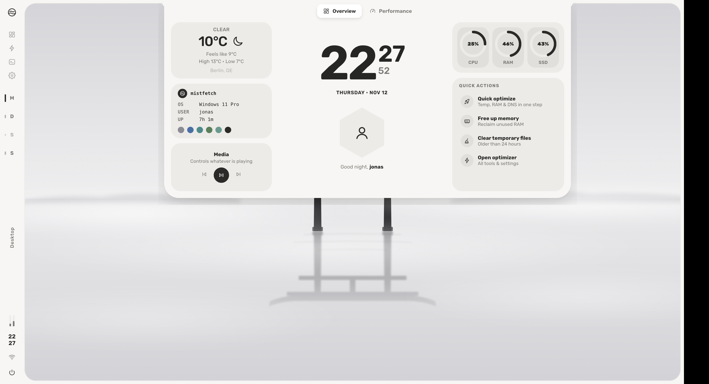

# Mist

A minimalist desktop shell and PC optimizer for Windows 10/11, built with Electron.

Mist lays a clean, "creamy" overlay on top of Windows — a side bar, a misty wallpaper, a
drop-down dashboard, a launcher and a terminal — and bundles a reversible optimizer
(cleanup, RAM, power plans, game tweaks, startup, processes). It changes **no** system
files, themes or wallpapers: when you quit, everything is exactly as it was.



## Run it

Download **`Mist-<version>-portable.exe`** from the
[Releases](../../releases) page, copy it to your Windows PC and double-click. No install.

> The build is **not code-signed**, so Windows SmartScreen shows a warning the first time
> ("Windows protected your PC"). Click **More info → Run anyway**. If you'd rather be sure,
> build it yourself from source (below) — the whole app is plain HTML/JS you can read.

## Features

**Shell**
- Vertical **side bar** (clock, foreground-window title, quick access, running-window buttons)
- **Misty wallpaper** with a rounded frame — Torii, Misty mountains, Minimal, or your own image
- **Dashboard** — weather, big clock, `mistfetch`, media keys, CPU/RAM/SSD rings, quick actions
  (open with `Ctrl+Alt+D` or move the mouse to the top-center of the screen)
- **Launcher** (`Ctrl+Alt+Space`) — apps, commands and a calculator
- **Terminal** (`Ctrl+Alt+T`) — runs PowerShell, plus `fetch` and `sl`
- Light & dark theme, smooth animations (all toggleable)

**Replace the Windows shell** (like Windhawk, but non-destructive)
- Auto-hide or fully hide the Windows taskbar so only the Mist bar shows
- Show running windows as buttons in the Mist bar (click to switch, middle-click to close)

**Optimizer** (`Ctrl+Alt+O`)
- Storage cleanup (temp, crash dumps, shader/browser/thumbnail caches, Recycle Bin)
- Free up RAM, flush DNS
- Power plans incl. Ultimate Performance; Windows power mode
- Game tweaks (Game Mode, Game DVR off, mouse-acceleration off, reduce animations, …)
- Startup manager and process list

## Reset / turn it off (nothing breaks)

Every optimization stores its original value first. Nothing is permanent.

- **`Ctrl+Alt+Shift+M`** — kill switch, hides the whole shell instantly
- **Optimizer → Reset** — see every active change and undo it; create a Windows restore
  point; "Repair desktop" (restart Explorer); "Reset everything & quit"
- **Tray icon → Undo everything and quit**
- If Mist crashes twice in a row it starts next time **without** the shell (safe mode)
- To uninstall: *Reset everything & quit*, then delete the `.exe`
  (settings live in `%APPDATA%\Mist`)

## Known first-run notes

- **Wallpaper not visible?** "Behind icons" uses the same desktop-layer trick as live-wallpaper
  apps. Windows 11 24H2 briefly blocked such apps; if the wallpaper stays hidden, switch
  **Appearance → Wallpaper mode** to "Bottom layer".
- **Weather** defaults to Berlin; change the location under Appearance.

## Build from source

```bash
npm install
npm run build:win
```

The portable `.exe` lands in `dist/`. Requires Node 18+ and runs the build on any OS
(electron-builder cross-builds the Windows target).

## Tech

Electron + a tiny vanilla-JS renderer (no framework). Win32 calls go through
[koffi](https://koffi.dev) (`SetParent`/WorkerW for the wallpaper, `SHAppBarMessage` for the
reserved bar, `EmptyWorkingSet` for RAM). Bundled font: **Rubik** (SIL Open Font License).

## License

MIT
